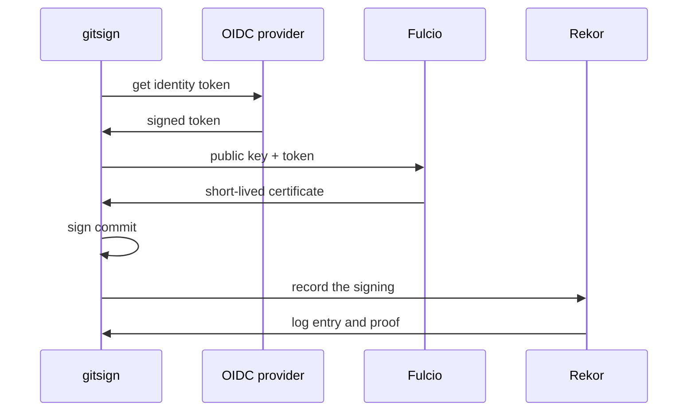

# How Gitsign Signs A Commit

Before you configure a tool that signs your work, you need to know what it signs, with which key, and what it leaves behind. This part follows one gitsign signing from start to end. It shows where Git keeps a signature, what the certificate inside it says, and why the transparency log matters for a key that only lives for a few minutes.

## Where Git keeps a signature

A Git commit is a small text object: the tree (the files), the parent commits, the author, the committer and the message. When a commit is signed, Git adds one more header to that object, called `gpgsig`. The header holds the signature, and the signature covers every other line of the commit object. So if anyone changes a file, the author or the message, the signature no longer matches.

Git does not sign anything itself. It calls a signing program and stores what that program returns. The setting `gpg.format` says which kind of program to call (`openpgp`, `x509` or `ssh`), and gitsign is an `x509` program: it returns a signature in the Cryptographic Message Syntax (CMS) format, the format S/MIME email signatures also use, with an X.509 certificate inside.

Look at the signed commit the playground made on the branch `demo/signed`. In the workstation shell, go to the clone and print the raw commit object:

<!-- astrona:playground:renew -->

```sh
cd /root/inventory-app
git log --oneline --all
git cat-file commit origin/demo/signed
```

The log shows the commits on `main` and one more on `demo/signed`. The raw object starts with `tree`, `parent`, `author` and `committer` lines. Then comes the `gpgsig` header: a block of base64 text between a `BEGIN` and an `END` line, indented by one space on every line. The commit message follows after a blank line. Now compare it with a commit on `main`:

```sh
git cat-file commit origin/main
```

That commit has the same kinds of lines but no `gpgsig` header. It is unsigned, and Git shows no difference between the two in a normal `git log`.

## The keyless signing flow

A traditional signature needs a private key that you create once and protect for years. If it leaks, every signature it ever made becomes doubtful. Keyless signing removes the long-lived key. gitsign makes a new key pair for the signing and throws the private key away afterwards. The trick is the certificate: it binds that short-lived public key to an identity that an identity provider vouched for.



The diagram shows the order: gitsign gets an identity token, Fulcio turns it into a certificate for the new key, gitsign signs the commit, and Rekor records the signing.

Step by step, this is what each component does:

1. **The OpenID Connect (OIDC) provider** issues an identity token: a signed JSON Web Token (JWT) that says who you are. On the public Sigstore instance this is a browser login with GitHub, Google or Microsoft. In this playground it is the Kubernetes API server, which issues service account tokens.
2. **Fulcio** checks the token's signature and its audience (the `aud` claim must be `sigstore`), then issues an X.509 certificate for gitsign's new public key. The certificate is valid for about ten minutes. Its subject alternative name (SAN) holds the identity, and an extension holds the OIDC issuer.
3. **gitsign** signs the commit with the new private key and puts the signature and the certificate into the `gpgsig` header.
4. **Rekor** records the signing in its append-only log and returns a proof that the entry is in the log, with the time it was added.

The token this workstation uses is a file. The kubelet puts the token of the service account `developer` there, with the audience `sigstore`, and renews it before it expires. Read its claims with `jq`:

```sh
jq -R 'split(".")[1] | @base64d | fromjson' /var/run/sigstore/cosign/oidc-token
cat /trust/issuer
```

The claims show `aud` set to `sigstore`, `iss` set to this cluster's issuer (the same URL that `/trust/issuer` holds), `sub` naming the service account, and a `kubernetes.io` section with the namespace `workstation` and the service account `developer`. Fulcio turns that into the identity `https://kubernetes.io/namespaces/workstation/serviceaccounts/developer`.

## Why the log matters

The certificate in the commit expires about ten minutes after the signing. A plain X.509 check later would call it expired and reject it. The Rekor entry solves this: Rekor recorded the signing while the certificate was still valid, and its proof carries that time. So a verifier checks the signature against the certificate as it was at the time Rekor recorded it.

gitsign can work with Rekor in two modes, chosen with the environment variable `GITSIGN_REKOR_MODE`:

| Mode | What is stored in Rekor | What is stored in the commit | How verification finds the proof |
| --- | --- | --- | --- |
| `online` (default) | The commit hash | The signature and certificate | It searches Rekor for the entry |
| `offline` | A hash of the commit content | The signature, certificate and the Rekor proof | It reads the proof from the commit; no search needed |

The gitsign documentation says online verification will be deprecated in favour of offline mode. The workstation sets `GITSIGN_REKOR_MODE=offline`:

```sh
echo "$GITSIGN_REKOR_MODE"
```

It prints `offline`. So every commit you sign here carries its own log proof, and verification works without a search.

You now know where Git keeps a signature, what gitsign puts into it, and which component does what in a keyless signing. A Fulcio certificate names the signer, and the Rekor proof shows the certificate was valid when the signing happened. What is still open is how to make Git call gitsign, and how to point gitsign at this private Fulcio and Rekor instead of the public ones.

## Common pitfalls

> [!WARNING]
> - **Trusting the author line.** The author and committer of a commit are plain text. Only a signature, checked against an expected identity, says who made the commit.
> - **Expecting a long-lived key.** gitsign throws the private key away after the signing. There is nothing to back up and nothing to rotate; the identity token is the credential.
> - **Reading an expired certificate as a broken signature.** The certificate always expires minutes after the signing. The Rekor proof is what makes it verifiable later.
> - **Mixing up the token audience.** Fulcio only accepts a token whose `aud` claim is `sigstore` here. A service account token with the default audience is refused.
