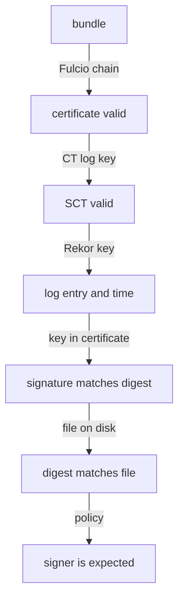

# What A Verifier Checks

Before you write a verifier, you need to know exactly what it must check. A bundle carries several pieces of evidence, and each one is checked against a different key or certificate. This part opens a real bundle and the trusted root of the private stack, and then uses `cosign verify-blob` as the reference for every check your own code will make.

## What is in a bundle

The playground signed `release.txt` with cosign as the service account `developer` and wrote the bundle `release.txt.sigstore.json` next to it. A Sigstore bundle is a JSON document with three top-level fields. Open a shell in the workstation and list them:

<!-- astrona:playground:renew -->

```sh
kubectl -n workstation exec -it deploy/workstation -- sh
cd /tmp/data
jq 'keys' release.txt.sigstore.json
jq '.mediaType, (.verificationMaterial | keys), (.messageSignature | keys)' release.txt.sigstore.json
```

The fields are `mediaType`, which names the bundle format version, `verificationMaterial`, which holds the certificate and the transparency log entries, and `messageSignature`, which holds the digest of the file and the signature over it. Each part has one job:

| Field | What it holds | What a verifier does with it |
| --- | --- | --- |
| `verificationMaterial.certificate` | The short-lived Fulcio certificate, with the signer's identity | Checks it chains to Fulcio, and reads the identity |
| `verificationMaterial.tlogEntries` | The Rekor entry: log index, integrated time, inclusion proof | Checks the entry is in the log and when it was added |
| `messageSignature.messageDigest` | The SHA-256 digest of the signed file | Compares it with the digest of the file on disk |
| `messageSignature.signature` | The signature over that digest | Checks it with the public key in the certificate |

The digest in the bundle is base64-encoded. Compute the digest of the file on disk the same way and compare the two:

```sh
jq -r '.messageSignature.messageDigest.digest' release.txt.sigstore.json
openssl dgst -sha256 -binary release.txt | base64
openssl dgst -sha256 -binary release-tampered.txt | base64
```

The bundle's digest is the same as the digest of `release.txt`, and different from the digest of `release-tampered.txt`. That one comparison already catches a file that changed after signing.

## What is in a trusted root

A bundle carries its own certificate, so a verifier needs something it already trusts to check that certificate. That is the **trusted root**: a JSON document with the certificate chain of every Fulcio the verifier accepts, and the public keys of every transparency log and certificate transparency (CT) log. On the public instance, clients download it with The Update Framework (TUF). Here the environment built it for the private stack with `cosign trusted-root create` and mounted it at `/trust/trusted_root.json`:

```sh
jq 'keys' /trust/trusted_root.json
jq '[.tlogs[].baseUrl, .ctlogs[].baseUrl, .certificateAuthorities[].uri]' /trust/trusted_root.json
```

The trusted root has the fields `certificateAuthorities`, `tlogs` (Rekor), `ctlogs` and `timestampAuthorities`, and it names the three private services. A bundle signed by a Fulcio that is not in this file fails, however valid its signature is.

## The checks, in order

A verifier makes its checks in a fixed order, and each check uses a different part of the trusted root or the bundle:



The diagram shows the chain of checks, from the certificate to the identity; a failure at any step rejects the file.

In words: the certificate must chain to a Fulcio in the trusted root, and it must have been valid at the time Rekor recorded the signing. The certificate must carry a signed certificate timestamp (SCT) from a CT log in the trusted root, which proves Fulcio published the certificate. The Rekor entry must be in the log, checked with the log's key, and its integrated time is the signing time. The signature must match the digest, and the digest must match the file. Last, the certificate's identity must be the one you expect.

`cosign verify-blob` makes all these checks, and it is the reference your own code has to match. Run it on the three files, with the identity of the developer:

```sh
ISSUER="$(cat /trust/issuer)"
DEVELOPER="https://kubernetes.io/namespaces/workstation/serviceaccounts/developer"
cosign verify-blob --trusted-root /trust/trusted_root.json --bundle release.txt.sigstore.json \
  --certificate-identity "$DEVELOPER" --certificate-oidc-issuer "$ISSUER" release.txt
cosign verify-blob --trusted-root /trust/trusted_root.json --bundle release.txt.sigstore.json \
  --certificate-identity "$DEVELOPER" --certificate-oidc-issuer "$ISSUER" release-tampered.txt
cosign verify-blob --trusted-root /trust/trusted_root.json --bundle other.txt.sigstore.json \
  --certificate-identity "$DEVELOPER" --certificate-oidc-issuer "$ISSUER" other.txt
```

The first command reports that the signature is verified. The second fails because the digest does not match the file. The third fails even though `other.txt` and its bundle are a valid pair, because the certificate names the service account `intruder`, not `developer`.

You now know what a bundle and a trusted root hold, and the order of the checks a verifier makes. You also have three test cases with known answers: one that must pass, one changed file and one wrong signer. What is still open is how to make the same checks from Go code.

## Common pitfalls

> [!WARNING]
> - **Checking only the signature.** A valid signature from the wrong signer is still a valid signature. The identity check is what tells signers apart.
> - **Trusting the certificate in the bundle on its own.** The bundle brings its own certificate; only the trusted root says which Fulcio to believe.
> - **Expecting an expired certificate to fail.** Fulcio certificates expire minutes after signing. The verifier checks them against the time in the transparency log entry.
> - **Using the public trusted root for a private stack.** The private Fulcio and Rekor are not in the public trusted root, so every bundle fails.
